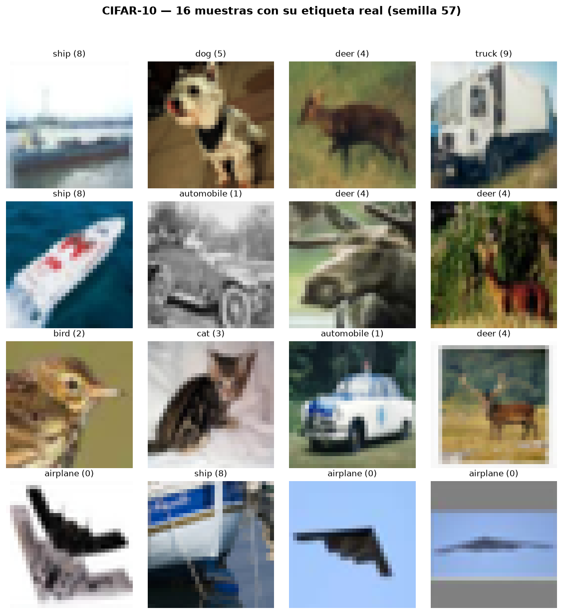
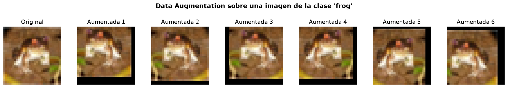
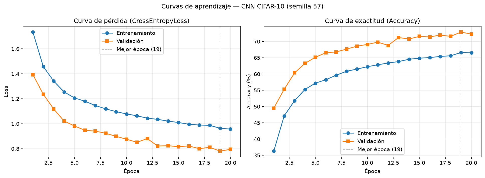
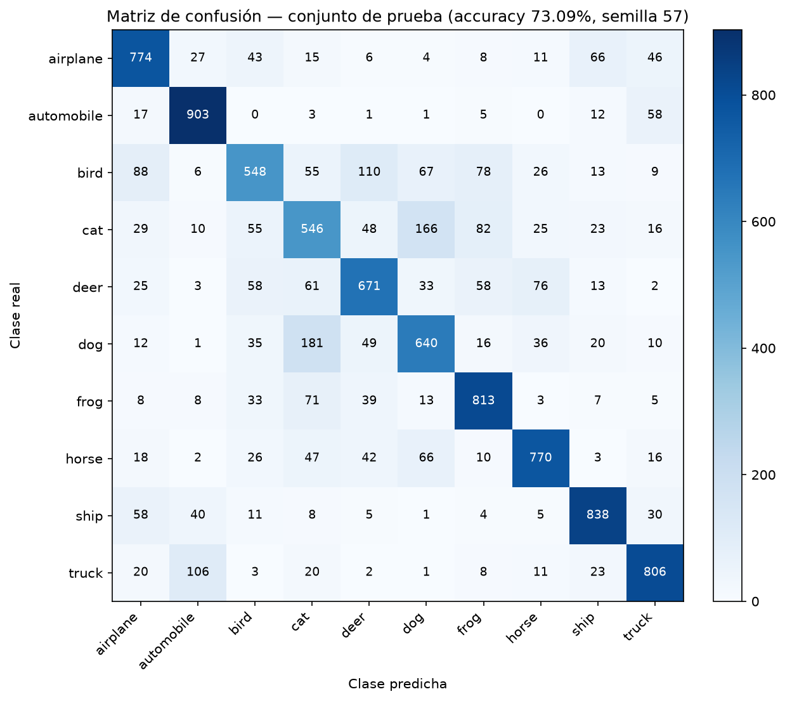
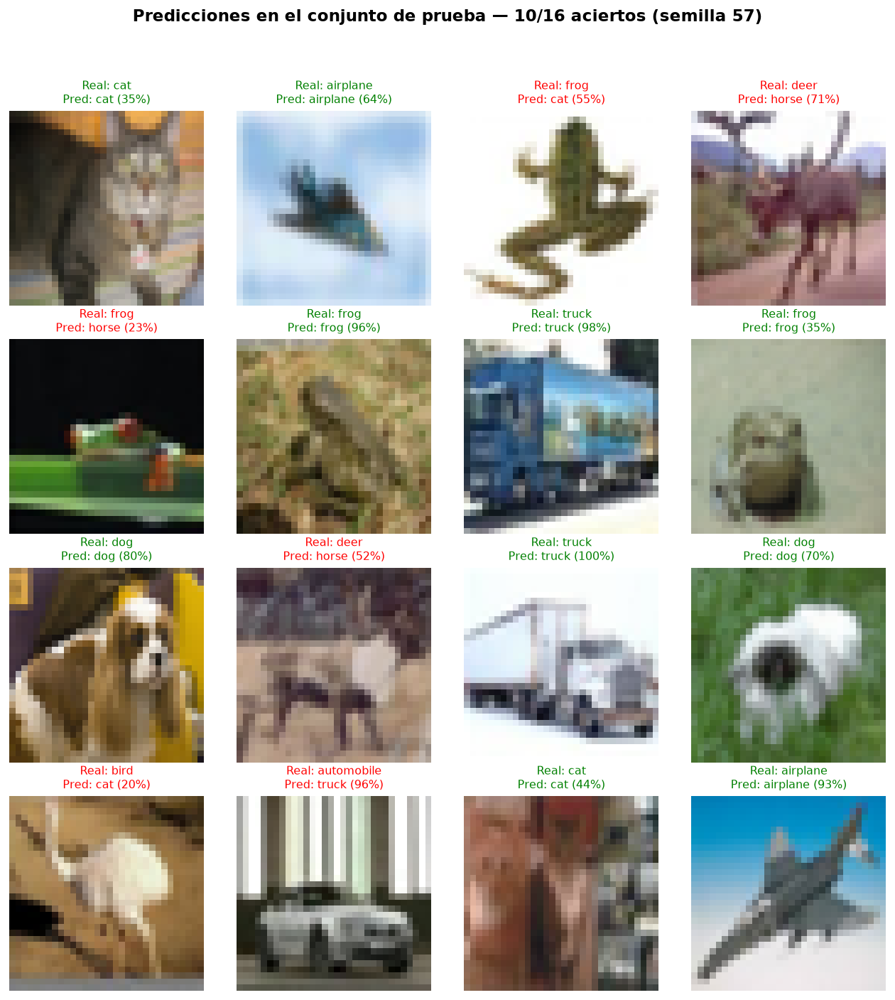
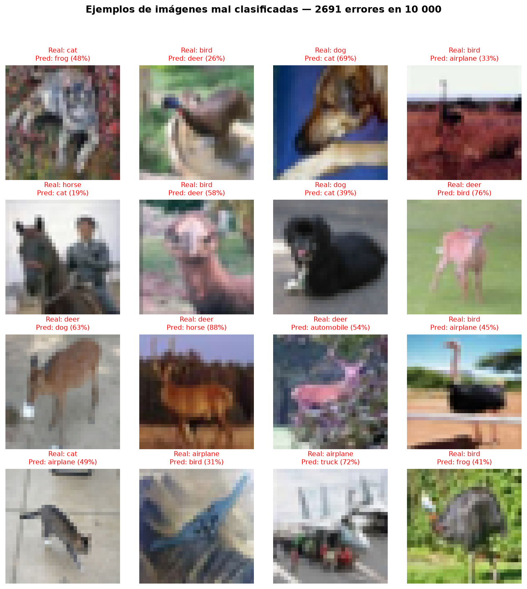

# Clasificación de imágenes CIFAR-10 mediante CNN — Flujo de tensores 4D y análisis de métricas

**Universidad Andina del Cusco · Departamento Académico de Ingeniería de Sistemas**
**Curso:** Inteligencia Artificial · **Evaluación de la Segunda Unidad**

| Dato | Valor |
|---|---|
| Estudiante | Jerson Americo Peña Salgueron |
| Código de matrícula | 021101457b |
| Semilla individual | **57** (dos últimos dígitos numéricos del código) |
| Framework | Python 3 + PyTorch + torchvision |
| Entorno | Windows + Visual Studio Code |

---

## 1. Objetivo

Diseñar, implementar, entrenar y evaluar una Red Neuronal Convolucional (CNN) que clasifique las fotografías de CIFAR-10 en 10 clases, controlando de forma rigurosa el flujo de tensores 4D `(Batch_Size, Channels, Height, Width)` y analizando cuantitativamente su capacidad de generalización (overfitting / underfitting) con una ejecución individualizada mediante la semilla 57.

## 2. Dataset: CIFAR-10

- 60 000 imágenes RGB de 32 × 32 píxeles, en 10 clases balanceadas: `airplane, automobile, bird, cat, deer, dog, frog, horse, ship, truck`.
- Conjunto oficial de entrenamiento: 50 000 imágenes (5 000 por clase).
- Conjunto oficial de prueba: 10 000 imágenes (1 000 por clase).
- Se carga de forma nativa con `torchvision.datasets.CIFAR10` y se descarga automáticamente en `data/` (carpeta excluida de Git).

**Partición utilizada.** La guía no fija un porcentaje, por lo que se propone una partición **estratificada 80 / 20** del conjunto oficial de entrenamiento:

| Subconjunto | Imágenes | Por clase | Transformaciones |
|---|---:|---:|---|
| Entrenamiento | 40 000 | 4 000 | Data Augmentation + ToTensor + Normalize |
| Validación | 10 000 | 1 000 | ToTensor + Normalize |
| Prueba (independiente) | 10 000 | 1 000 | ToTensor + Normalize |

El conjunto de prueba **no se usa** durante el entrenamiento ni para elegir el mejor modelo; solo se usa una vez al final.

## 3. Semilla individual y reproducibilidad

```python
SEED = 57
random.seed(SEED); np.random.seed(SEED); torch.manual_seed(SEED)
torch.cuda.manual_seed_all(SEED)               # si hay GPU
torch.backends.cudnn.deterministic = True
torch.backends.cudnn.benchmark = False
```

La semilla 57 controla:

1. **La partición**: `train_test_split(..., stratify=targets, random_state=57)`.
2. **El shuffle**: `DataLoader(..., shuffle=True, generator=torch.Generator().manual_seed(57))`.
3. **Los pesos iniciales** de la red (inicialización aleatoria de `Conv2d` y `Linear`).
4. **El Data Augmentation** (recortes y volteos aleatorios) y el Dropout.

Todos los resultados numéricos de este documento corresponden a una ejecución con semilla 57. Aun con la semilla fija, los valores pueden variar ligeramente entre equipos (CPU frente a GPU, versión de PyTorch/cuDNN, operaciones de punto flotante no deterministas en GPU), pero las conclusiones deben mantenerse.

## 4. Estructura del repositorio

```text
cnn_cifar10_semilla57/
├── src/
│   ├── dataset.py         # Pregunta 1: carga, semilla, transformaciones, partición y visualización
│   ├── model.py           # Pregunta 3: arquitectura CNN, Flatten y validación de shapes
│   ├── train.py           # Pregunta 4: entrenamiento, evaluación y gráficas
│   └── predict.py         # Pruebas visuales del modelo entrenado sobre el conjunto de prueba
├── notebooks/
│   └── experiment.ipynb   # Pruebas, EDA, visualización de muestras y forward pass
├── outputs/
│   ├── loss_accuracy.png      # Curvas de aprendizaje (generado por train.py)
│   ├── confusion_matrix.png   # Matriz de confusión (generado por train.py)
│   ├── results_summary.md     # Tablas de métricas (apoyo para este README)
│   ├── metrics.json · history.csv · classification_report.txt
│   ├── samples_grid.png · augmentation_examples.png  (generados por dataset.py)
│   └── test_predictions.png · test_errors.png        (generados por predict.py)
├── requirements.txt
├── .gitignore
└── README.md
```

## 5. Instalación y ejecución (Windows + Visual Studio Code)

```powershell
# 1. Crear y activar el entorno virtual (en la terminal de VS Code, carpeta del proyecto)
python -m venv .venv
.\.venv\Scripts\Activate.ps1

# 2. Instalar dependencias
python -m pip install --upgrade pip
pip install -r requirements.txt

# 3. Ejecutar en orden
python src/dataset.py     # Pregunta 1
python src/model.py       # Pregunta 3
python src/train.py       # Pregunta 4 (genera outputs/)
python src/predict.py     # Pruebas visuales del modelo entrenado
```

Opciones de entrenamiento: `python src/train.py --epochs 20 --batch-size 64 --lr 0.001 --dropout 0.5`.

Para el notebook: abrir `notebooks/experiment.ipynb` en VS Code, elegir el kernel `.venv` y ejecutar todas las celdas.

## 6. Metodología de procesamiento (Pregunta 1)

1. **Carga**: `datasets.CIFAR10(root="data", train=True/False, download=True)`.
2. **Exploración**: dimensiones `(50000, 32, 32, 3)` y `(10000, 32, 32, 3)`, distribución por clase y estadísticas de píxeles por canal.
3. **Visualización**: cuadrícula de 16 imágenes con su etiqueta real (`outputs/samples_grid.png`).
4. **Transformaciones** (`torchvision.transforms`):
   - `RandomCrop(32, padding=4)`: rellena 4 píxeles por lado y recorta 32 × 32 en una posición aleatoria, simulando pequeños desplazamientos del objeto.
   - `RandomHorizontalFlip(p=0.5)`: refleja la imagen horizontalmente; un gato mirando a la izquierda sigue siendo un gato.
   - `ToTensor()`: convierte la imagen de `uint8 [0, 255]` en formato HWC a `float32 [0, 1]` en formato CHW.
   - `Normalize(mean=(0.4914, 0.4822, 0.4465), std=(0.2470, 0.2435, 0.2616))`: centra cada canal RGB en ~0 con desviación ~1, lo que estabiliza el descenso del gradiente.
5. **Partición estratificada** reproducible 80/20 con semilla 57, verificando que no existan índices repetidos entre entrenamiento y validación.
6. **DataLoaders** con `batch_size = 64`; solo el de entrenamiento mezcla (shuffle) los datos.

**Muestras del dataset con su etiqueta real (semilla 57):**



**Efecto del Data Augmentation sobre una misma imagen:**



## 7. Justificación teórica: MLP frente a CNN (Pregunta 2)

### 7.1 ¿Qué es un MLP?

Un Perceptrón Multicapa (MLP) es una red de capas **totalmente conectadas**: cada neurona recibe *todas* las salidas de la capa anterior. Su entrada debe ser un vector, por lo que una imagen debe **aplanarse** antes de ingresar a la red.

### 7.2 Por qué un MLP es ineficiente con CIFAR-10

**a) Aplanamiento y pérdida de estructura espacial.** Una imagen de 32 × 32 × 3 se convierte en un vector de 3 072 valores. En ese vector, dos píxeles vecinos en vertical quedan separados por 32 posiciones (y los canales de un mismo píxel, por 1 024 en formato CHW). La red no sabe qué valores eran vecinos: si se permutaran los 3 072 valores con un mismo orden fijo, un MLP aprendería exactamente igual. Toda la geometría de la imagen (bordes, texturas, formas) debe reaprenderse desde cero a partir de los datos.

**b) Explosión del número de parámetros.** Cada neurona de la primera capa tiene un peso por cada valor de entrada:

| Capa densa sobre la imagen aplanada | Parámetros |
|---|---:|
| `Linear(3072 → 512)` | 3 072 × 512 + 512 = **1 573 376** |
| `Linear(3072 → 1024)` | 3 072 × 1 024 + 1 024 = **3 146 752** |
| MLP 3072 → 512 → 256 → 10 (total) | **1 707 274** |

Con solo 50 000 imágenes, tantos parámetros libres facilitan memorizar el entrenamiento (overfitting) y aumentan el costo de memoria y cómputo. El problema crece rápidamente con la resolución: una imagen de 224 × 224 × 3 tendría 150 528 entradas por neurona.

**c) Sin reutilización de lo aprendido según la posición.** Si un MLP aprende a detectar una rueda en la esquina inferior izquierda, ese conocimiento está en pesos que solo miran esa zona. Para reconocer la misma rueda en otra posición necesita ejemplos de entrenamiento con la rueda allí. Los objetos de CIFAR-10 aparecen en posiciones variables, así que el MLP desperdicia capacidad aprendiendo el mismo patrón muchas veces.

Por tanto, un MLP **no es incapaz** de clasificar CIFAR-10 (puede obtener resultados modestos), pero es **estructuralmente ineficiente**: usa muchos más parámetros, ignora la estructura espacial y generaliza peor que una CNN de tamaño comparable.

### 7.3 Cómo lo resuelven las CNN

| Propiedad | Qué significa | Beneficio en CIFAR-10 |
|---|---|---|
| **Conexiones locales** | Cada neurona de una capa convolucional mira solo una ventana pequeña (3 × 3) de la entrada (su *campo receptivo*). | Aprende patrones locales (bordes, esquinas, texturas) y respeta la vecindad entre píxeles. |
| **Weight Sharing (compartición de pesos)** | El mismo filtro (kernel) se desliza por toda la imagen; sus pesos son idénticos en todas las posiciones. | El primer bloque usa solo 896 parámetros para producir 32 mapas de 32 × 32, frente a millones en una capa densa. |
| **Equivarianza a traslaciones** | Si el objeto se desplaza, el mapa de activación se desplaza igual. | Un detector de "ojo" funciona en cualquier parte de la imagen. |
| **Invariancia local (MaxPool2d)** | El pooling conserva el valor máximo de cada ventana 2 × 2. | Pequeños desplazamientos no cambian la salida; además reduce H y W a la mitad. |
| **Jerarquía de características** | Bloques sucesivos combinan patrones simples en patrones complejos. | Bordes → texturas → partes de objetos → clase. |

En la CNN propuesta, las dos capas convolucionales suman solo **19 392** parámetros. La mayoría de los parámetros (524 416) se concentran en la primera capa densa, que opera sobre características ya extraídas (4 096 valores) y no sobre píxeles crudos.

### 7.4 Justificación de la arquitectura seleccionada

- **Dos bloques convolucionales** (mínimo exigido): suficiente para una imagen de 32 × 32; tras dos `MaxPool2d` el mapa queda en 8 × 8, con un campo receptivo que ya cubre partes significativas del objeto.
- **Kernel 3 × 3 con `padding=1`**: conserva H y W dentro de la convolución, de modo que solo el pooling reduce la resolución (cálculo de dimensiones predecible).
- **Canales 32 → 64**: al reducir la resolución espacial se duplica la cantidad de filtros, para compensar con más tipos de características.
- **ReLU**: no linealidad simple que evita la saturación del gradiente de sigmoide/tanh.
- **Dropout(0.5)** en la parte densa: regulariza la capa con más parámetros.
- **Sin Softmax al final**: la red entrega *logits*; `CrossEntropyLoss` aplica `LogSoftmax` + `NLLLoss` internamente, de forma numéricamente más estable.

## 8. Arquitectura del modelo y flujo de tensores 4D (Preguntas 2 y 3)

### 8.1 Diagrama

```text
Entrada            [B, 3, 32, 32]
   │  Conv2d(3→32, k=3, s=1, p=1)
   ▼               [B, 32, 32, 32]
   │  ReLU
   │  MaxPool2d(2)
   ▼               [B, 32, 16, 16]        ← Bloque convolucional 1
   │  Conv2d(32→64, k=3, s=1, p=1)
   ▼               [B, 64, 16, 16]
   │  ReLU
   │  MaxPool2d(2)
   ▼               [B, 64, 8, 8]          ← Bloque convolucional 2
   │  Flatten
   ▼               [B, 4096]
   │  Linear(4096→128) + ReLU + Dropout(0.5)
   ▼               [B, 128]
   │  Linear(128→10)
   ▼               [B, 10]   (logits por clase)
```

### 8.2 Especificación por capa

| # | Capa | Configuración | Entrada | Salida | Parámetros |
|---|---|---|---|---|---:|
| 1 | Conv2d | 3→32, k=3, s=1, p=1 | [B, 3, 32, 32] | [B, 32, 32, 32] | 896 |
| 2 | ReLU | — | [B, 32, 32, 32] | [B, 32, 32, 32] | 0 |
| 3 | MaxPool2d | k=2, s=2 | [B, 32, 32, 32] | [B, 32, 16, 16] | 0 |
| 4 | Conv2d | 32→64, k=3, s=1, p=1 | [B, 32, 16, 16] | [B, 64, 16, 16] | 18 496 |
| 5 | ReLU | — | [B, 64, 16, 16] | [B, 64, 16, 16] | 0 |
| 6 | MaxPool2d | k=2, s=2 | [B, 64, 16, 16] | [B, 64, 8, 8] | 0 |
| 7 | Flatten | start_dim=1 | [B, 64, 8, 8] | [B, 4096] | 0 |
| 8 | Linear | 4096→128 | [B, 4096] | [B, 128] | 524 416 |
| 9 | ReLU + Dropout | p=0.5 | [B, 128] | [B, 128] | 0 |
| 10 | Linear | 128→10 | [B, 128] | [B, 10] | 1 290 |
| | **Total** | | | | **545 098** |

### 8.3 Cálculo matemático de las dimensiones

Para convolución y pooling: **H_out = ⌊(H_in + 2p − k) / s⌋ + 1** (igual para W).

- Conv2d bloque 1: (32 + 2·1 − 3) / 1 + 1 = **32** → los canales pasan de 3 a 32 (número de filtros).
- MaxPool2d: ⌊(32 − 2) / 2⌋ + 1 = **16**.
- Conv2d bloque 2: (16 + 2 − 3) / 1 + 1 = **16** → canales de 32 a 64.
- MaxPool2d: ⌊(16 − 2) / 2⌋ + 1 = **8**.
- Flatten: 64 × 8 × 8 = **4 096** valores por imagen. La dimensión del batch `B` se conserva.

Parámetros de una Conv2d: (C_in × k × k + 1) × C_out → (3·9 + 1)·32 = 896 y (32·9 + 1)·64 = 18 496.

### 8.4 Cómo se evita el Shape Mismatch

El error típico ocurre cuando `in_features` de la primera `Linear` no coincide con `C × H × W` del último bloque convolucional (por ejemplo, escribir `Linear(64*16*16, 128)` olvidando el segundo pooling). En `src/model.py` se aplican tres protecciones:

1. **`nn.Flatten()`** aplana desde la dimensión 1, conservando el batch: `[B, 64, 8, 8] → [B, 4096]`.
2. **Cálculo dinámico** (`_get_flatten_size`): se pasa un tensor ficticio `torch.zeros(1, 3, 32, 32)` por los bloques convolucionales y se usa `numel()` como `in_features` de la primera capa lineal, en lugar de escribirlo a mano.
3. **Validación con aserciones** (`validate_forward_pass`): un lote simulado `torch.randn(8, 3, 32, 32)` recorre el modelo capa por capa, se imprime cada shape y se comprueba con `assert` que la salida final sea `[8, 10]` y que coincida con `forward()`.

## 9. Configuración del entrenamiento (Pregunta 4)

| Elemento | Valor |
|---|---|
| Función de pérdida | `nn.CrossEntropyLoss()` (recibe logits) |
| Optimizador | `torch.optim.Adam` |
| Tasa de aprendizaje | 0.001 |
| Weight decay | 0 |
| Tamaño de lote | 64 |
| Épocas | 20 |
| Dropout | 0.5 |
| Selección del modelo | Pesos de la época con mayor accuracy de validación |
| Dispositivo | CUDA si está disponible; si no, CPU |

En cada época: `model.train()` → recorrido de los 625 lotes de entrenamiento (forward, pérdida, `backward()`, `optimizer.step()`) → `model.eval()` + `torch.no_grad()` sobre los 157 lotes de validación. Se registran Loss y Accuracy de entrenamiento y validación. Al final se cargan los mejores pesos y se evalúa **una sola vez** sobre el conjunto de prueba.

## 10. Resultados (ejecución con semilla 57)

Ejecución realizada en CPU con 20 épocas; tiempo total de entrenamiento: 7.9 minutos (≈ 18–25 s por época).

| Métrica | Valor |
|---|---:|
| Dispositivo / tiempo total | CPU / 7.9 min |
| Mejor época (según validación) | 19 |
| Val Loss / Val Acc (mejor época) | 0.7811 / 72.89 % |
| Train Loss / Train Acc (última época) | 0.9573 / 66.52 % |
| Val Loss / Val Acc (última época) | 0.7956 / 72.28 % |
| Train Acc − Val Acc (última época) | −5.76 puntos |
| **Test Loss / Test Accuracy** | **0.7799 / 73.09 %** |

**Evolución resumida por época** (tabla completa en [`outputs/results_summary.md`](outputs/results_summary.md)):

| Época | Train Loss | Train Acc (%) | Val Loss | Val Acc (%) |
|---:|---:|---:|---:|---:|
| 1 | 1.7339 | 36.30 | 1.3930 | 49.50 |
| 5 | 1.2069 | 57.19 | 0.9824 | 65.15 |
| 10 | 1.0787 | 62.24 | 0.8767 | 69.10 |
| 15 | 1.0100 | 64.87 | 0.8163 | 71.57 |
| 18 | 0.9871 | 65.61 | 0.8119 | 71.58 |
| **19 (mejor)** | **0.9642** | **66.60** | **0.7811** | **72.89** |
| 20 | 0.9573 | 66.52 | 0.7956 | 72.28 |

**Métricas por clase en el conjunto de prueba (1 000 imágenes por clase):**

| Clase | Precision | Recall | F1-score |
|---|---:|---:|---:|
| airplane | 0.738 | 0.774 | 0.756 |
| automobile | 0.817 | 0.903 | 0.858 |
| bird | 0.675 | 0.548 | 0.605 |
| cat | 0.542 | 0.546 | 0.544 |
| deer | 0.690 | 0.671 | 0.680 |
| dog | 0.645 | 0.640 | 0.643 |
| frog | 0.751 | 0.813 | 0.781 |
| horse | 0.800 | 0.770 | 0.785 |
| ship | 0.823 | 0.838 | 0.831 |
| truck | 0.808 | 0.806 | 0.807 |
| **Promedio macro** | **0.729** | **0.731** | **0.729** |

### 10.1 Curvas de aprendizaje



### 10.2 Matriz de confusión (conjunto de prueba)



**Confusiones más frecuentes (real → predicha)** sobre un total de 2 691 errores en 10 000 imágenes:

| Real | Predicha | Casos |
|---|---|---:|
| dog | cat | 181 |
| cat | dog | 166 |
| bird | deer | 110 |
| truck | automobile | 106 |
| bird | airplane | 88 |

### 10.3 Predicciones en el conjunto de prueba

Generado con `python src/predict.py` a partir de los pesos de la mejor época. Título verde: acierto; rojo: error; entre paréntesis, la confianza del modelo.



### 10.4 Ejemplos de errores del modelo



## 11. Análisis crítico: overfitting y underfitting

**Criterios utilizados.**
- *Overfitting*: el accuracy de entrenamiento sigue subiendo mientras el de validación se estanca, la brecha train − val crece (más de ~10 puntos) y la pérdida de validación **aumenta** después de alcanzar su mínimo.
- *Underfitting*: ambos accuracies son bajos y las pérdidas siguen altas o todavía bajando al final: el modelo no tiene capacidad o tiempo suficiente.
- *Ajuste adecuado*: ambas curvas mejoran juntas, la brecha es pequeña y la pérdida de validación se estabiliza.

**Evolución de la pérdida.** La pérdida de entrenamiento bajó de 1.7339 (época 1) a 0.9573 (época 20), y la de validación de 1.3930 a 0.7956. La pérdida de validación alcanzó su mejor valor, 0.7811, en la época 19, y en la época 20 solo varió levemente (+0.0145), sin una tendencia sostenida al alza. **No aparece la firma típica del overfitting**, en la que la pérdida de validación sube mientras la de entrenamiento sigue bajando.

**Brecha de generalización.** En la última época, el accuracy de entrenamiento fue 66.52 % y el de validación 72.28 %: la validación supera al entrenamiento en 5.76 puntos, y lo hace desde la época 1 (36.30 % frente a 49.50 %). Esto no es un error, sino el efecto de la regularización. El accuracy de entrenamiento se mide sobre imágenes alteradas (RandomCrop y RandomHorizontalFlip) y con Dropout(0.5) apagando la mitad de las neuronas densas, mientras que la validación usa imágenes limpias y el modelo completo en modo `eval()`. Una brecha negativa descarta que la red haya memorizado el conjunto de entrenamiento.

**Generalización en prueba.** El accuracy en el conjunto de prueba independiente fue 73.09 % (loss 0.7799), prácticamente igual al de validación en la mejor época (72.89 %, loss 0.7811). La diferencia de solo 0.2 puntos muestra que la validación fue un buen estimador del rendimiento real y que el modelo generaliza a imágenes nunca vistas.

**Diagnóstico.** El modelo **no presenta overfitting** y muestra un **leve underfitting por entrenamiento incompleto**:
1. La mejor época fue la 19 de 20; el modelo seguía mejorando cuando terminó el entrenamiento.
2. Las ganancias por época se reducen (+1.3 puntos de val acc entre las épocas 15 y 19), pero la curva todavía no se aplana por completo.
3. El accuracy de entrenamiento (66.52 %), aunque reducido por la regularización, indica que la red todavía no se ajusta del todo a los datos.
4. La arquitectura es deliberadamente pequeña (dos bloques convolucionales, 545 098 parámetros) y está fuertemente regularizada, lo que limita su capacidad.

**Análisis por clase.** Las clases mejor reconocidas fueron automobile (recall 0.903), ship (0.838) y frog (0.813): tienen formas y contextos distintivos, como carreteras, agua o el color verde característico. Las más difíciles fueron cat (0.546) y bird (0.548). La confusión más frecuente fue **dog → cat (181 casos)**, seguida de **cat → dog (166 casos)**: ambas clases comparten tamaño, textura de pelaje y postura, y a 32 × 32 píxeles se pierden los rasgos finos que las distinguen (hocico, orejas). También destacan bird → deer (110), por el fondo natural compartido; truck → automobile (106), por la forma de vehículo con ruedas; y bird → airplane (88), por la silueta con alas sobre cielo azul. Los errores se concentran entre clases visualmente parecidas y no son aleatorios, lo que indica que el modelo aprendió características visuales con sentido.

**Posibles mejoras.** Dado el diagnóstico de underfitting leve, se proponen:
- Entrenar más épocas (30–40), ya que las curvas aún no se estabilizaron.
- Aumentar la capacidad con un tercer bloque convolucional (64 → 128 filtros) o añadir `BatchNorm2d` después de cada convolución, para acelerar la convergencia.
- Reducir el Dropout a 0.3, porque la regularización actual es fuerte para un modelo de este tamaño.
- Usar un *scheduler* de tasa de aprendizaje (por ejemplo, `ReduceLROnPlateau`) para afinar en las últimas épocas.

## 12. Conclusiones

1. La CNN aprovecha la estructura espacial de las imágenes mediante conexiones locales y compartición de pesos: con 545 098 parámetros totales, sus capas convolucionales usan solo 19 392, mientras que una sola capa densa de un MLP sobre la imagen aplanada (3072 → 1024) ya requeriría 3 146 752.
2. El flujo de tensores 4D `[B, 3, 32, 32] → [B, 32, 16, 16] → [B, 64, 8, 8] → [B, 4096] → [B, 10]` se verificó con aserciones; el cálculo dinámico del tamaño aplanado evita el Shape Mismatch.
3. La semilla 57 hace reproducible la partición estratificada (40 000 / 10 000, con 4 000 y 1 000 imágenes por clase), el orden de los lotes y los pesos iniciales.
4. Con 20 épocas en CPU, el modelo alcanzó un **73.09 % de accuracy en el conjunto de prueba** independiente, frente al 10 % esperado de una clasificación al azar. No presenta overfitting (validación y prueba superan al entrenamiento) y muestra un leve underfitting por entrenamiento incompleto, que podría reducirse con más épocas o mayor capacidad.
5. Los errores se concentran en clases visualmente similares (perro/gato, camión/automóvil, ave/avión), lo que confirma que la red aprendió características visuales coherentes.

## Referencias

Goodfellow, I., Bengio, Y., & Courville, A. (2016). *Deep learning*. MIT Press.

Krizhevsky, A. (2009). *Learning multiple layers of features from tiny images* [Technical report]. University of Toronto.

LeCun, Y., Bottou, L., Bengio, Y., & Haffner, P. (1998). Gradient-based learning applied to document recognition. *Proceedings of the IEEE, 86*(11), 2278–2324. https://doi.org/10.1109/5.726791

